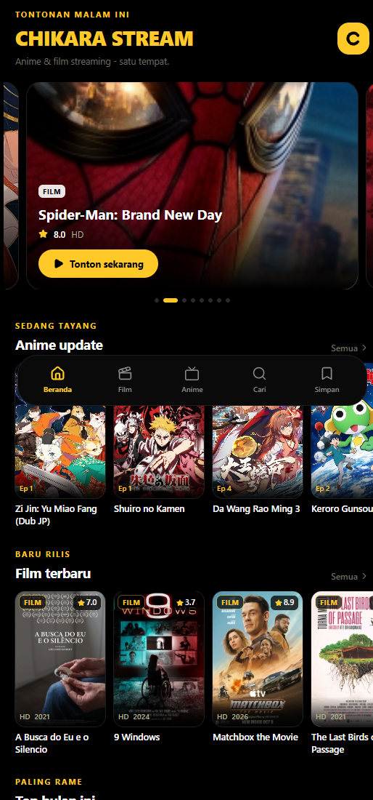
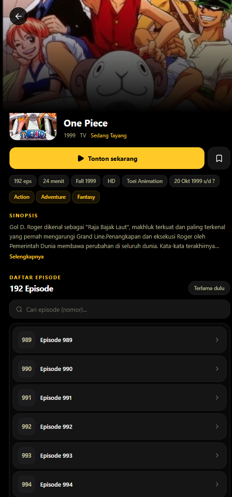
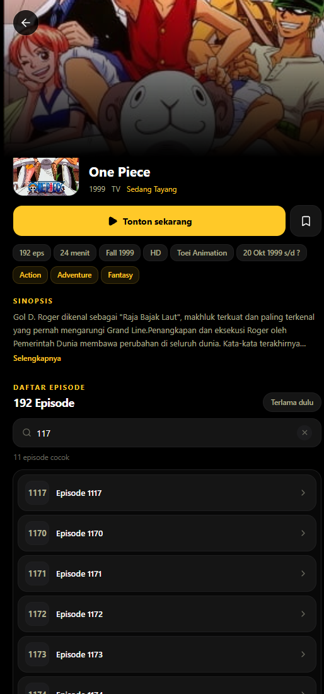

# Chikara Stream

Aplikasi mobile nonton **anime + film jadi satu** - dibangun dengan React 19 + Vite + Tailwind 4, dibungkus Capacitor 8 jadi APK Android.

<p align="center">
  <a href="https://github.com/Azkaahps/chikara-stream/releases/latest"></a>
  
  
</p>

<p align="center">
  <a href="https://github.com/Azkaahps/chikara-stream/releases/latest"><b>Download APK terbaru</b></a>
</p>

<p align="center">
  
  
  
</p>

## Fitur

- **Loading screen** - splash brand dengan prefetch data beranda (buka app -> beranda langsung terisi)
- **Beranda** - featured carousel, lanjut nonton, rail anime update + film terbaru + top bulan + drakor
- **Film** - katalog LK21 dengan filter genre + pagination
- **Anime** - katalog Kuramanime (Update / Ongoing / Movie)
- **Cari** - pencarian gabungan anime + film (debounced) + riwayat pencarian
- **Simpan** - watchlist + riwayat nonton (lokal, tanpa login)
- **Detail anime** - daftar episode lengkap dalam card scroll + pencarian nomor episode + auto-scroll ke episode terakhir ditonton
- **Player** - MP4 (kuramadrive, hydrax) + HLS (cast/p2p) via proxy API, pemilih kualitas, failover server otomatis, resume posisi nonton, **fullscreen landscape**
- **Update otomatis (OTA)** - app cek versi baru saat dibuka, banner update dengan progress download, install satu tap (tanpa kirim APK manual)

## Optimasi (HP kentang)

- hls.js di-lazy-load (hanya saat server movie HLS dipakai) dan pakai build `light` - bundle utama 920 KB -> 348 KB
- Cache API in-memory (5 menit) + persist feed beranda ke localStorage -> buka app instan / tetap jalan saat sinyal jelek
- Buffer HLS dibatasi (memory kecil)
- Animasi hanya transform/opacity; `backdrop-blur` dihapus dari UI
- `content-visibility: auto` untuk rail di luar layar
- Gambar poster lazy + async decode

## Arsitektur

```
src/
|-- lib/
|   |-- api.ts       # client api.azkahps.online (anime + movie + proxy) + cache
|   |-- types.ts     # tipe API + model lokal
|   |-- player.ts    # resolusi stream + hook useVideoPlayback (HLS/MP4, lazy hls.js)
|   |-- updater.ts   # cek versi OTA + download + install (native)
|   |-- persist.ts   # mirror localStorage ke native (survive app update)
|   |-- store.ts     # watchlist + progress (localStorage + native backup)
|   |-- hooks.ts     # useAsync, useDebounced
|   `-- native.ts    # status bar + back button (Capacitor)
|-- components/      # TitleCard, Rail, TopBar, TabBar, VideoPlayer, UpdateBanner, Logo, Skeleton
`-- screens/         # Home, Movies, Anime, Search, Library, *Detail, *Watch, GenreResults, Splash
```

Stream playback selalu lewat proxy `api.azkahps.online/api/v1/proxy/*` (CORS + referer upstream ditangani server).

## Update otomatis (OTA)

Android tidak mengizinkan install APK tanpa konfirmasi user (kebijakan keamanan), jadi alurnya:

1. App dibuka -> cek `version.json` di Google Drive (lewat native Filesystem, bebas CORS)
2. Ada `versionCode` lebih baru -> banner "Versi X tersedia" muncul di beranda
3. User tap update -> APK di-download ke cache dengan progress -> dialog installer sistem muncul -> tap Install

Untuk merilis versi baru: bump `versionCode` + `versionName` di `android/app/build.gradle`, lalu:

```bash
bash scripts/publish.sh "catatan rilis"
```

Script ini build APK signed, upload ke Google Drive (file ID stabil karena nama file sama), dan update `version.json`. App yang terinstall akan menawarkan update saat dibuka.

## Build APK

```bash
# sekali setup
npm install
npx cap add android   # sudah dilakukan, folder android/ ada di repo

# signing: copy template lalu isi dengan keystore kamu sendiri
cp keystore.properties.example keystore.properties
# (atau pakai keystore milikmu + ubah storeFile di keystore.properties)

# build
bash scripts/build_apk.sh
# output: Chikara-Stream.apk
```

Prasyarat: JDK 21, Android SDK (compileSdk 36), Gradle 8.14 (via wrapper).

Tanpa `keystore.properties`, build tetap jalan tapi menghasilkan APK unsigned (buat dev/testing).

## Dev (browser)

```bash
npm run dev
```

## API

Data dari [api.azkahps.online](https://api.azkahps.online) - unified scraper API (anime: Kuramanime, film: LK21). Endpoint yang dipakai app:

| Endpoint | Fungsi |
|---|---|
| `/api/v1/anime/home` | Beranda anime (update terbaru) |
| `/api/v1/anime/ongoing` | Anime ongoing |
| `/api/v1/anime/movies` | Anime movie |
| `/api/v1/anime/search?q=` | Cari anime |
| `/api/v1/anime/detail/{id}/{slug}` | Detail anime + batch episode terbaru |
| `/api/v1/anime/episodes/{id}/{slug}` | **Daftar episode lengkap** (walk pagination upstream, cache SQLite 24 jam) |
| `/api/v1/anime/stream/{id}/{slug}/{ep}` | Sumber video episode |
| `/api/v1/movie/home` | Beranda film |
| `/api/v1/movie/detail/{slug}` | Detail film + daftar player |
| `/api/v1/movie/stream/{server}/{id}` | Sumber video film |
| `/api/v1/proxy/hls?url=` | Proxy HLS |
| `/api/v1/proxy/image?url=` | Proxy gambar |

## Design

Mengadaptasi design language AniBiPlay (design-lab/06-anibiplay-mobile): hitam pekat, aksen kuning `#FFC928`, radius besar, eyebrow uppercase, poster-forward, bottom nav pill melayang.

## Struktur repo

```
src/                  # aplikasi React
android/              # project Android (Capacitor)
scripts/              # build_apk.sh, publish.sh, make_icons.py, make_splash.py
docs/screenshots/     # screenshot untuk README
keystore.properties.example  # template signing (isi sendiri)
```

## Catatan

- Aplikasi ini hanya client. Semua konten berasal dari sumber pihak ketiga via API publik; repo ini tidak menyimpan media apa pun.
- Signing key (`azkahps-release.keystore`) dan `keystore.properties` tidak masuk repo - pakai milikmu sendiri untuk build release.
